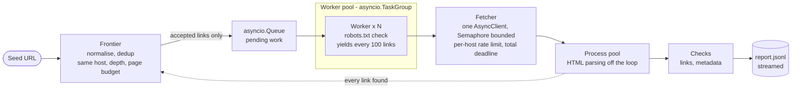
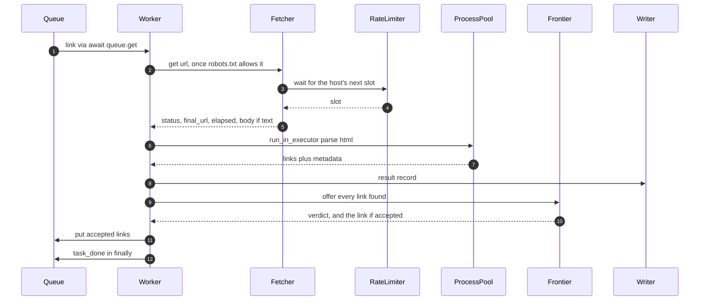

<div align="center">

# site-auditor

### A concurrent site crawler and link-health auditor

**`asyncio` for network I/O · a process pool for HTML parsing · every performance claim backed by a benchmark in this repository**

<br>

[](https://github.com/subham-hq/site-auditor/actions/workflows/ci.yml)


**[Overview](#overview) · [Status](#status) · [Architecture](#architecture) · [Usage](#usage) · [Performance](#performance) · [Decisions](#design-decisions) · [Build log](#build-log)**

</div>

---

> [!WARNING]
> **Not usable yet — Phases 00 to 03 of 08 are done; the command line arrives in Phase 05.**
> The repository is public from the first commit so the design and the build sequence are
> visible, not because there is anything to install. Nothing in this document describes
> working software except where the [Status](#status) table says so.
>
> No performance figure will appear here that `benchmarks/` cannot reproduce.

<br>

<details>
<summary><b>Table of contents</b></summary>

- [Overview](#overview)
  - [What it does](#what-it-does)
  - [Non-goals](#non-goals)
- [Status](#status)
  - [Build phases](#build-phases)
- [Architecture](#architecture)
  - [Crawl pipeline](#crawl-pipeline)
  - [Lifecycle of a single page](#lifecycle-of-a-single-page)
  - [The dependency rule](#the-dependency-rule)
  - [Module layout](#module-layout)
- [Usage](#usage)
- [Performance](#performance)
- [Engineering standards](#engineering-standards)
- [Design decisions](#design-decisions)
- [Why this exists](#why-this-exists)
- [Build log](#build-log)
- [Limitations](#limitations)
- [License](#license)

</details>

<br>

## Overview

Point it at a host. It crawls breadth-first within that host, checks the health of every
link it finds, extracts and validates page metadata, and writes a report a CI pipeline can
act on.

The interesting part is not the crawling. It is doing it **concurrently without lying about
it** — bounded in-flight requests, correct cancellation, streamed output that keeps memory
flat, and a benchmark honest enough to report the parts that lost.

### What it does

| | Capability |
|:---:|---|
| 🕸️ | Concurrent breadth-first crawl of a single host, bounded by depth and page budget |
| 🔗 | Per-link status code, final URL after redirects, and response time |
| 🚨 | Detects broken links (4xx/5xx), redirect chains, and mixed-content links |
| 🏷️ | Page metadata checks — `<title>`, meta description, canonical, `h1` count |
| 🤖 | `robots.txt` compliance and per-host rate limiting |
| 🔁 | Retries transient failures with backoff and jitter; never retries a 4xx |
| 📄 | Streams JSONL to disk — memory stays flat across thousands of pages |
| ⏹️ | Ctrl-C exits cleanly, flushes partial results, returns `130` |
| ✅ | Exit code `1` when links are broken, so it can gate a build |

### Non-goals

<details>
<summary><b>Deliberately out of scope — these are decisions, not a backlog</b></summary>

<br>

| Not building | Why |
|---|---|
| Web dashboard or HTTP API | Dilutes the focus. This is a CLI tool that fits in a pipeline. |
| Distributed workers (Celery, Redis) | Unjustifiable complexity at this scale, and indefensible in review. |
| Database persistence | JSONL is the correct output for a stateless auditor. |
| Headless-browser JS rendering | Changes what the tool fundamentally is. |
| Authenticated / login-walled crawling | Out of scope for a public link auditor. |
| SEO scoring or sitemap generation | A different product wearing the same hat. |
| Entry-point plugin system | The `Check` protocol already covers extension. |
| Output formats beyond JSONL and console | Two formats, both done well. |

> [!NOTE]
> This table is the scope contract. It was written before the first commit and is not
> expected to grow — if something moves from here into the feature list, that is a decision
> worth recording in the [decision log](#design-decisions), not a quiet edit.

</details>

<br>

---

## Status

```
Phase ▰▰▰▰▱▱▱▱ 4 / 8 complete
```

**What works today:** the crawl engine, driven from Python. `crawl()` takes a seed URL, a
fetcher and a robots policy and returns an `AuditReport`; it has crawled 150 pages of
docs.python.org under asyncio's debug mode. There is no command line until Phase 05.

| # | Phase | Delivers | Status |
|:---:|---|---|:---:|
| 00 | Scaffold | packaging, `mypy --strict`, `ruff`, green CI | ✅ |
| 01 | Core model | models, protocols, URL normalisation, frontier | ✅ |
| 02 | Network layer | async fetcher, retry, rate limit, robots | ✅ |
| 03 | Crawl engine | queue, worker pool, cancellation | ✅ |
| 04 | Parsing | HTML off the event loop, pluggable checks | ⬜ |
| 05 | Interface | streaming JSONL, console summary, CLI | ⬜ |
| 06 | Benchmark | four execution models over a fixed corpus | ⬜ |
| 07 | Harden | test coverage, docs, `v1.0.0` | ⬜ |

### Build phases

<details>
<summary><b>Phase 00 — Scaffold</b></summary>

<br>

A repository that does nothing, perfectly.

- [x] `uv init`, `src/` layout, console-script entry point
- [x] Toolchain pinned: `ruff`, `mypy`, `pytest`, `pytest-asyncio`, `httpx`
- [x] `mypy --strict` configured; `ruff` rules chosen deliberately, not copied
- [x] `errors.py` — `AuditError` hierarchy, written before anything can raise
- [x] GitHub Actions running lint, type-check and tests on push

**Done when** `uv run siteaudit --version` prints a version and CI is green on an empty
test suite.

</details>

<details>
<summary><b>Phase 01 — Core model</b></summary>

<br>

Everything pure and synchronous, tested to the floor. No network.

- [x] `models.py` — frozen dataclasses with `slots=True`
- [x] `protocols.py` — `Fetcher` and `Check`
- [x] `urls.py` — normalisation, same-host predicate, relative resolution
- [x] `frontier.py` — dedup set, depth tracking, budget guard
- [x] Adversarial URL tests: fragments, uppercase hosts, protocol-relative, `mailto:`,
      `javascript:`, default ports, percent-encoding

**Done when** `test_urls.py` covers 15+ hostile cases and the frontier refuses duplicates,
off-host URLs and over-budget URLs.

</details>

<details>
<summary><b>Phase 02 — Network layer</b></summary>

<br>

The network, behind the Protocol.

- [x] `fetcher.py` — one `AsyncClient`, explicit `httpx.Limits`, async context manager
- [x] `decorators.py` — `@retry` with exponential backoff and jitter; policy as data
- [x] `ratelimit.py` — per-host even spacing
- [x] `robots.py` — fetched once, parsed, honoured

**Done when** `FakeFetcher` satisfies the `Fetcher` protocol without inheriting from it, and
the retry test uses a fetcher that fails twice then succeeds — no mocking library anywhere.

</details>

<details>
<summary><b>Phase 03 — Crawl engine</b></summary>

<br>

The heart of the project. Budget the most time here and expect one rewrite.

- [x] `asyncio.Queue` of pending work, N workers inside a `TaskGroup` — the frontier
      decides, the queue distributes ([ADR-004](#design-decisions))
- [x] `Semaphore` in-flight bound; `asyncio.timeout()` per request, covering the whole
      exchange ([ADR-009](#design-decisions))
- [x] Correct termination: `await queue.join()` then cancel; `task_done()` in `finally`
- [x] Cancellation unwinds every worker and leaves no task behind; a refused seed raises
      instead of returning an empty report ([ADR-005](#design-decisions))
- [x] Developed under `debug=True` against a real site, every slow-callback warning traced
      to its cause ([ADR-007](#design-decisions))
- [x] A malformed link is a verdict, never a crash ([ADR-008](#design-decisions)); a seed
      that redirects is followed to its final host ([ADR-002](#design-decisions))

**Done when** a 50-page crawl runs entirely off `FakeFetcher`, a cancelled crawl unwinds
every worker without hanging, and both are proven by tests in CI. Ctrl-C with partial output
and exit code `130` moved to Phase 05, where the streaming writer makes it possible.

</details>

<details>
<summary><b>Phase 04 — Parsing</b></summary>

<br>

The CPU half, where the GIL stops being theory. It starts from a measured problem: on
docs.python.org one page's parse still holds the event loop for about 194 ms
([ADR-007](#design-decisions)).

- [ ] `parsing.py` — pure, picklable, dependency-free functions
- [ ] `ProcessPoolExecutor` via `run_in_executor`, size configurable
- [ ] `checks/links.py` and `checks/meta.py`, both structurally matching `Check`
- [ ] `--no-process-pool` flag so both paths stay benchmarkable

**Done when** adding a third check requires editing `cli.py` only, and both execution paths
produce byte-identical reports.

</details>

<details>
<summary><b>Phase 05 — Interface</b></summary>

<br>

Usable by someone who is not me, including a machine.

- [ ] Async JSONL writer consuming a results queue, one record per line
- [ ] Console summary: counts by status class, slowest pages, broken links
- [ ] `cli.py` as composition root — parse, construct, inject, run
- [ ] Exit codes wired through
- [ ] Ctrl-C exits with code `130` after flushing partial results — moved here from Phase 03
      ([ADR-005](#design-decisions))

**Done when** it runs from a clean clone and memory stays flat across a 500-page crawl —
measured, not assumed.

</details>

<details>
<summary><b>Phase 06 — Benchmark</b></summary>

<br>

The artifact that turns a claim into evidence.

- [ ] Fixed local corpus, served over loopback
- [ ] Four execution models over the identical workload
- [ ] Wall clock and peak memory, median of five runs
- [ ] `RESULTS.md` — the table, then the explanation

**Done when** the table reproduces on a second machine and the write-up is honest about
anything that lost.

</details>

<details>
<summary><b>Phase 07 — Harden</b></summary>

<br>

The phase most people skip, and the one that gets read.

- [ ] Test gaps closed — delete any module and something fails
- [ ] Architecture documented, decision log complete
- [ ] `v1.0.0` tagged, clean clone verified

**Done when** every README claim traces to a test or a benchmark row.

</details>

<br>

---

## Architecture

### Crawl pipeline



### Lifecycle of a single page



> [!IMPORTANT]
> **`task_done()` lives in a `finally` block.** One exception on the path to it and
> `await queue.join()` never returns — the crawler hangs with no output and no traceback.
> This is the single most likely bug in the whole project.

### The dependency rule

<details>
<summary><b>Why <code>crawler.py</code> imports nothing concrete</b></summary>

<br>

`crawler.py` imports no concrete implementation from this package — not the fetcher, not the
robots policy, not the checks, not the report writer. It reaches each of them through
`protocols.py`; everything else it imports (`models`, `frontier`, `parsing`, `errors`) is
pure and does no I/O. `cli.py` is the only module permitted to construct real
implementations and inject them.

```
        protocols.py
       ↗      ↑      ↖
crawler.py  fetcher.py  checks/
       ↖      ↑      ↗
           cli.py            ← the only place concretes are wired
```

Two things this buys, both testable:

1. **The engine runs with no network.** A `FakeFetcher` returning canned HTML from a dict
   satisfies the protocol structurally — no inheritance, no mocking library.
2. **Implementations swap without an edit.** The engine cannot know or care.

If `crawler.py` grows a concrete import, that is a design regression, not a convenience.

</details>

### Module layout

<details>
<summary><b>Repository structure</b></summary>

<br>

```
site-auditor/
├── src/siteaudit/
│   ├── cli.py          composition root — the only place concretes are wired
│   ├── models.py       Page, Link, Response, CheckResult, AuditReport
│   ├── protocols.py    Fetcher, RobotsChecker, Check — the seams
│   ├── errors.py       AuditError hierarchy
│   ├── urls.py         normalisation, same-host predicate (pure, sync)
│   ├── frontier.py     dedup set, depth tracking, budget guard
│   ├── robots.py       robots.txt fetch and verdict
│   ├── ratelimit.py    per-host even spacing
│   ├── decorators.py   @retry with backoff and jitter
│   ├── fetcher.py      httpx.AsyncClient wrapper: deadline, text-only reads
│   ├── crawler.py      the engine — queue, workers, TaskGroup
│   ├── parsing.py      pure CPU functions, picklable, no package imports
│   ├── checks/
│   │   ├── links.py    broken links, redirect chains, mixed content
│   │   └── meta.py     title, description, canonical, h1 count
│   └── reports.py      async JSONL writer, console summary
├── benchmarks/
│   ├── corpus/         fixed local pages, served over loopback
│   ├── bench.py        four execution models, one workload
│   └── RESULTS.md      the table and the explanation
└── tests/
    ├── fakes.py        FakeFetcher — no mocking library
    ├── test_urls.py    the hardest-tested module in the repo
    ├── test_crawler.py including a cancellation test
    ├── test_fetcher.py the real fetcher, through httpx.MockTransport
    └── ...
```

</details>

<br>

---

## Usage

> [!NOTE]
> Not functional yet. Recorded here so the interface is settled before it is built.

```bash
uv sync

uv run siteaudit https://example.com \
    --max-depth 3 \
    --max-pages 500 \
    --concurrency 20 \
    --out report.jsonl
```

<details>
<summary><b>All flags</b></summary>

<br>

| Flag | Default | Purpose |
|---|:---:|---|
| `--max-depth` | `3` | How far from the seed URL to crawl |
| `--max-pages` | `500` | Hard ceiling on pages admitted to the crawl. Failed fetches still count against it |
| `--concurrency` | `20` | In-flight request bound |
| `--timeout` | `10` | Per-request deadline, seconds |
| `--rate` | `5` | Requests per second, per host |
| `--out` | `report.jsonl` | Streamed output path |
| `--no-process-pool` | off | Parse inline — for benchmark comparison |
| `--user-agent` | `siteaudit/1.0` | Sent on every request |

</details>

<details>
<summary><b>Output format</b></summary>

<br>

One JSON object per line, written as results arrive — never accumulated in memory.

```jsonc
{"url":"https://example.com/pricing","status":200,"final_url":"https://example.com/pricing","elapsed_ms":84.2,"depth":1,"checks":[]}
{"url":"https://example.com/old","status":301,"final_url":"https://example.com/new","elapsed_ms":61.7,"depth":2,"checks":[{"check":"links","severity":"warn","message":"redirect chain length 2"}]}
{"url":"https://example.com/gone","status":404,"final_url":"https://example.com/gone","elapsed_ms":39.1,"depth":2,"checks":[{"check":"links","severity":"error","message":"broken link"}]}
```

</details>

<details>
<summary><b>Exit codes</b></summary>

<br>

| Code | Meaning |
|:---:|---|
| `0` | Crawl completed, no broken links |
| `1` | Crawl completed, broken links found |
| `2` | Usage error |
| `130` | Interrupted — partial results written |

Which makes it usable as a build gate:

```yaml
- name: Audit links
  run: uv run siteaudit https://staging.example.com --max-pages 300
```

</details>

<br>

---

## Performance

> [!NOTE]
> **Awaiting Phase 06.** The protocol below is fixed in advance so the results cannot be
> shaped after the fact.

| Model | Implementation | Wall clock | Peak memory |
|:---:|---|:---:|:---:|
| A · Sequential | one request at a time | — | — |
| B · Threaded | `ThreadPoolExecutor` | — | — |
| C · Async | `AsyncClient`, bounded | — | — |
| D · Async + processes | C, parsing in a process pool | — | — |

<details>
<summary><b>Measurement protocol</b></summary>

<br>

- **Local corpus** of static pages served over loopback — never a live third-party site,
  which is neither reproducible nor polite
- **Median of five runs**, min and max reported
- Wall clock *and* peak memory, alongside machine, Python version and corpus size
- Request count identical across all four models, or the comparison is void
- Clock stopped **before** any output is printed

</details>

> [!TIP]
> Whether the process pool is worth its pickling overhead is an open question this
> benchmark exists to answer — including if the answer is no. A measured loss with a stated
> crossover point is a better result than an unverified win.

<br>

---

## Engineering standards

Held from Phase 00, not retrofitted at the end.

| Gate | Tool | Standard |
|---|---|---|
| Types | `mypy --strict` | Zero errors. Every `# type: ignore` carries a comment explaining itself. |
| Lint | `ruff` | Clean. Rules chosen deliberately, not copied. |
| Tests | `pytest`, `pytest-asyncio` | Delete any module and at least one test fails. |
| CI | GitHub Actions | Green on every push. Failing tests block the merge. |
| Packaging | `uv`, `src/` layout | `uv sync` on a clean clone is the entire setup. |

<details>
<summary><b>Local development</b></summary>

<br>

```bash
git clone https://github.com/subham-hq/site-auditor.git
cd site-auditor
uv sync

uv run pytest                 # tests
uv run mypy --strict src/ tests/   # type check
uv run ruff check .           # lint
uv run ruff format .          # format

python benchmarks/bench.py    # benchmark (Phase 06+)
```

</details>

<br>

---

## Design decisions

An append-only log. One entry per real trade-off, written **at the moment it is made** —
not reconstructed at the end.

<details>
<summary><code>ADR-000</code> · <i>Template — copy this for each new entry</i></summary>

<br>

**Context** — what forced a choice.

**Decision** — what was chosen.

**Alternatives rejected** — what else was on the table, and why it lost.

**Trade-off accepted** — what this costs. Every decision costs something; an entry with no
cost listed is not finished.

**Status** — accepted · superseded by ADR-00X

</details>

<details>
<summary><code>ADR-001</code> · <b>Response is a local type, not httpx.Response</b></summary>

<br>

**Context** — `crawler.py` needs a response object to work with. The obvious
choice is `httpx.Response`, since httpx is already the HTTP client.

**Decision** — Define a small frozen `Response` dataclass in `models.py` with
six fields: `url`, `final_url`, `status`, `elapsed_ms`, `content_type`, `text`.
`fetcher.py` adapts `httpx.Response` into it.

**Alternatives rejected** — Returning `httpx.Response` directly from the
`Fetcher` protocol. Simpler and better typed, but the protocol would then name
a third-party type, so `crawler.py` would transitively depend on httpx and the
dependency rule would be weaker than the README claims. Test fakes would also
have to construct real HTTP objects — headers, encodings — to exercise a queue.

**Trade-off accepted** — A small adapter in `fetcher.py`, and no access to
httpx features not projected here. Adding a field is cheap; unpicking the
coupling later would not be.

**Status** — accepted

</details>


<details>
<summary><code>ADR-002</code> · <b>Subdomains are distinct hosts</b></summary>

<br>

**Context** — `is_same_host` bounds the crawl: given a seed, it decides which
discovered links are in scope. It compares `.hostname`, so `www.example.com`
and `example.com` are two different hosts. That is strictly correct — they are
different names — but on most sites they serve the same content, and many sites
redirect one to the other.

**Decision** — Keep the strict comparison, and handle the redirect case with
`rebind_seed`. The seed is validated at construction from what the user typed;
if the first fetch redirects, `rebind_seed` re-points the host check at the
seed's final URL, so every later comparison is made against the host the site
actually canonicalises to. The crawler calls it on the seed's own response,
before any of its links reach the frontier, and the final URL is marked as seen
so the redirected home page is not fetched twice. It refuses once anything
beyond the seed has been accepted, so a crawl cannot change hosts partway
through.

**Alternatives rejected** — Stripping a leading `www.` before comparing would
fix the common case in one line, but it is a guess about site structure, and
wrong for any site where subdomains serve genuinely different content.
Comparing registrable domains is the more general version and needs the Public
Suffix List: naive last-two-labels turns `bbc.co.uk` into `co.uk`, so every
British domain becomes same-host. That is a real dependency for a marginal gain.

**Trade-off accepted** — A seed of `example.com` will not follow links to
`www.example.com` unless a redirect points it there first. On a site that
canonicalises to `www` but is reachable at the bare domain without redirecting,
the crawl finds nothing beyond the seed. The `skipped_off_host` counter is what
makes that visible rather than silent.

**Status** — accepted

</details>


<details>
<summary><code>ADR-003</code> · <b>protego over the stdlib robots parser</b></summary>

<br>

**Context** — `robots.py` needs to answer whether a URL is permitted. Python
ships `urllib.robotparser`, so the zero-dependency option was tried first.

Its entire matching logic is `filename.startswith(self.path)` — prefix matching,
nothing more. No `*` wildcards, no `$` end-anchor, both of which are in RFC 9309
and both of which real sites rely on. Tested against GitHub's live robots.txt:

| Rule | URL | stdlib | protego |
|---|---|:---:|:---:|
| `Disallow: /copilot/` | `/copilot/` | blocked | blocked |
| `Disallow: /search$` | `/search` | **allowed** | blocked |
| `Disallow: /*q=` | `/search?q=x` | **allowed** | blocked |
| `Disallow: /*/*/pulse` | `/a/b/pulse` | **allowed** | blocked |

GitHub's file is almost entirely wildcard rules, so the stdlib would have
honoured a handful and ignored the rest — while this README claimed robots.txt
compliance.

**Decision** — Use protego, which implements RFC 9309: wildcards, the `$`
anchor, and longest-match precedence.

**Alternatives rejected** — Keeping the stdlib. Not a trade of correctness for
convenience but a silent failure: nothing raises, the crawl looks clean, and
pages the site owner disallowed get fetched anyway. Hand-rolling the matching
was never considered — the precedence rules are subtle enough that getting them
wrong would reproduce exactly the problem being fixed.

**Trade-off accepted** — A third-party dependency where the stdlib would run.
Mitigated by protego shipping `py.typed`, so `mypy --strict` passes without
stubs, and by the parser being confined to one module: swapping it again would
touch `robots.py` and nothing else.

**Status** — accepted

</details>


<details>
<summary><code>ADR-004</code> · <b>The queue is the only list of pending work</b></summary>

<br>

**Context** — Phase 01 gave the frontier its own pending deque and a `pop()`,
expecting Phase 03 to wrap it in an `asyncio.Queue`. The engine needs a queue
that workers can await and that tracks completion — `queue.join()` is how a
crawl knows it is finished — and a deque does neither.

**Decision** — Replace the deque rather than wrap it. The frontier keeps only
the decision: `add()` normalises, deduplicates, enforces host, depth and page
budget, and returns its verdict with the accepted link, or `None`. The worker
puts accepted links on the `asyncio.Queue`. `pop()`, the deque and `__len__`
are gone.

**Alternatives rejected** — Wrapping, with `frontier.pop()` feeding
`queue.put()`. Two structures would hold the same pending set, and they
disagree the moment one changes without the other: a link added but not yet
popped is pending in one and absent from the other, while `join()` counts only
the queue. Moving the queue into the frontier would have made it async and
pulled an event loop into the one module whose value is that it needs none.

**Trade-off accepted** — The frontier knows what it has accepted, not what is
still waiting; the backlog belongs to the queue. The two stay consistent
through one rule: every `ACCEPTED` verdict is enqueued exactly once, which
`add()` enforces by returning the link only on acceptance.

**Status** — accepted

</details>


<details>
<summary><code>ADR-005</code> · <b>crawl() raises rather than return a report it cannot stand behind</b></summary>

<br>

**Context** — Two situations would let `crawl()` hand back a report that looks
like a result and is not one. A seed the frontier refuses — `max_pages=0`, say
— would produce an empty report, indistinguishable from a clean crawl of an
empty site. A crawl cancelled halfway would produce counters for half a site,
indistinguishable from a whole one.

**Decision** — A refused seed raises `ValueError` before any worker starts.
Cancellation propagates: the `TaskGroup` cancels every worker, `task_done()`
still runs in each worker's `finally`, and `CancelledError` reaches the
caller. No report is returned. Partial output becomes the job of Phase 05's
streaming writer, which will already have written every record it received.

**Alternatives rejected** — Catching `CancelledError` in `crawl()` and
returning the counters so far. It swallows a cancellation the caller asked
for, which breaks asyncio's contract, and the report it returns has no way to
say it is partial — `completed=False` already means the page budget ran out.

**Trade-off accepted** — Until Phase 05 an interrupted crawl produces nothing
at all. The Phase 03 plan promised Ctrl-C with partial output and exit code
`130`; that promise moved to Phase 05, where the writer can keep it.

**Status** — accepted

</details>


<details>
<summary><code>ADR-006</code> · <b>Transport failures are counted apart from findings</b></summary>

<br>

**Context** — The report had a single `errors` counter, and Phase 03 filled it
with fetch failures — DNS, refused connections, timeouts — because those were
the only errors that existed yet. Phase 04 adds checks whose findings carry a
severity: a broken link is an error, a redirect chain a warning.

**Decision** — `fetch_errors` counts transport failures. `errors` and
`warnings` are reserved for check findings and stay at zero until Phase 04
produces some.

**Alternatives rejected** — One counter for both. A healthy site behind a flaky
network and a broken site behind a fast one would report the same number, and
the report could not answer the first question anyone asks of it: is the site
broken, or was the way to it?

**Trade-off accepted** — Two counters to read instead of one, and `errors=0` in
every report until Phase 04 — which reads like a clean bill of health before
any check exists to issue one.

**Status** — accepted

</details>


<details>
<summary><code>ADR-007</code> · <b>Workers hand the event loop back while they process links</b></summary>

<br>

**Context** — Crawling 150 pages of docs.python.org at two requests a second,
with asyncio's debug mode reporting every callback over 20 ms, one worker step
held the event loop for **732 ms**. A step is everything between two awaits:
parsing a page, then offering every link on it to the frontier — about 500 a
page on average, thousands on the largest. Profiled on a synthetic corpus of
the same shape, `frontier.add` dominated the step rather than parsing, and
almost all of that was `normalize_url`.

A stall is not just slowness. While it lasts no timer fires, and the rate
limiter's spacing depends on timers firing on time. Measured against
`RateLimiter`, the worst-case gap between two requests to one host is the
interval minus the stall — at two requests a second, a 732 ms stall sent two
requests at once.

**Decision** — The link loop yields with `asyncio.sleep(0)` every 100 links. On
the same crawl the worst step fell to 194 ms and slow-callback warnings from 51
to 21, every remaining one ending at the yield. The test counts a canary task's
turns while a 1,000-link page is processed: 5 without the yield, at least 10
with it. Nothing is timed, so it cannot flake.

**Alternatives rejected** — Moving the link loop to a thread: `frontier.add`
mutates the seen set and `asyncio.Queue` is not thread-safe; both are
race-free only because they run on the loop's thread. Caching `normalize_url`:
it cut link processing about 3.7× on the synthetic crawl, but that is
throughput, not the stall's shape — it belongs to Phase 06, measured against
this baseline. Moving parsing off the loop is Phase 04's decision. Measured
with `asyncio.to_thread` on a 20,000-link page, the longest stall fell from
about 250 ms to under 15 ms, but link loops then shared the GIL with the parse
thread and ran slower, so the count of short stalls rose. Those numbers are
Phase 04's starting point.

**Trade-off accepted** — The remaining 194 ms is parsing: a chunk of 100 links
takes a few milliseconds, so the one long step left is a single `extract_links`
call, which a yield cannot split. At two requests a second it can
narrow the spacing to about 300 ms but not collapse it; above about five a
second, it could. Wall-clock time did not change and could not: 150 requests at
two a second is 75 seconds, before and after. The fix bought correctness, not
speed.

**Status** — accepted

</details>


<details>
<summary><code>ADR-008</code> · <b>An unparseable href is a verdict, not an exception</b></summary>

<br>

**Context** — `urljoin` raises `ValueError` on a malformed bracketed host such
as `http://[::1`. `extract_links` called it unguarded, so one such link on any
page ended the whole crawl: the worker raised, the `TaskGroup` cancelled the
rest, and `crawl()` raised an `ExceptionGroup` with no report. The frontier
already had a `MALFORMED` verdict for exactly this; the parser failed before
the frontier saw the link. Fuzzed with 30,044 hostile hrefs, `urljoin` raised
on 4,146 and `frontier.add` on none.

**Decision** — `extract_links` returns an href it cannot resolve exactly as
written. The frontier parses it with the same `urlsplit`, fails the same way,
and counts it `MALFORMED` — all 4,146 of them do. `parsing.py` still imports
nothing from the package, so it stays picklable for the Phase 04 process pool.

**Alternatives rejected** — Dropping the href in the parser: the crawl
survives, but the link vanishes from every count, and a link auditor that
loses broken links without a trace is worse than one that crashes on them. A
`try`/`except` around each page in the worker: also survives, but throws away
every other link on that page, and would swallow the next real bug along with
it. A malformed href is expected input, handled where URL policy lives.
Resolving in the frontier instead: the parser is the only place that will ever
see a document's `<base href>`, which resolution has to respect.

**Trade-off accepted** — The parser's contract is now "absolute URLs, or the
href as written when it cannot be resolved", and its correctness leans on the
frontier rejecting whatever `urljoin` rejects. Both use `urllib`'s `urlsplit`,
and a crawl-level test pins the behaviour.

**Status** — accepted

</details>


<details>
<summary><code>ADR-009</code> · <b>Every request is bounded in time and in what it downloads</b></summary>

<br>

**Context** — Two measurements of the real `HttpxFetcher` against a local
server. With `timeout=1.0`, a server sending one byte every quarter second held
a request open for 5.1 seconds, and the fetch succeeded: httpx applies its
timeout to each network operation, not to the request. And a link to a 50 MB
file came back with `text=None` after peaking at 105 MB of memory: the whole
body was read before the content type was looked at. A link auditor follows
links to installers, archives and videos, and each was being downloaded in
full only to be thrown away.

**Decision** — `asyncio.timeout()` covers the whole exchange — connect, headers
and body — and expiry becomes a `FetchError`. It starts after the rate limiter,
so time spent waiting for the host's turn is not charged to the server. The
response is streamed and the headers decide what happens next: only
`text/html` and `text/plain` are read — plain text because robots.txt travels
through the same fetcher — and only up to `max_body_bytes`, 10 MiB by default.
Anything else, and any text body over the cap, comes back with `text=None`
without being downloaded, which is what `Response.text` already documented.

**Alternatives rejected** — Tuning httpx's timeout: it is per operation by
design, so no value of it bounds a slow drip. A `HEAD` request before each
`GET` to learn the type and size: a second request per link doubles the load
on the site, and servers answer `HEAD` inconsistently. Truncating an oversized
page and parsing what arrived: links past the cut would vanish without a
trace.

**Trade-off accepted** — A text page over 10 MiB is checked by its status but
not parsed, and the summary does not yet say how many were; per-page records
arrive with Phase 05. For a skipped body, `elapsed_ms` is roughly the time to
headers rather than to a download that never happened.

**Status** — accepted

</details>

---

## Why this exists

Link checkers already exist. This one is built for what a link checker forces you to get
right: concurrency that stays bounded, politeness toward servers you do not own,
cancellation that never hangs, and CPU-bound parsing competing with network I/O for a single
thread. Each of those is a claim in this README, and each claim is meant to trace to a test
or, from Phase 06, a benchmark. Where one did not at first, the build log and the decision
log say so.

<br>

---

## Build log

Newest first. One entry per phase — what shipped, and what it cost.

| Date | Phase | Shipped | Notes |
|---|:---:|---|---|
| 2026-10-16 | 03 | Crawl engine — queue, workers, cancellation | A real-site debug run found a 732 ms loop stall; one malformed href could end any crawl |
| 2026-08-19 | 02 | Fetcher, retry, rate limit, robots | Stdlib robots parser silently allowed every wildcard rule; swapped to protego |
| 2026-08-03 | 01 | Models, protocols, urls, frontier   | is_same_host let mailto: through — None == None |
| 2026-08-03 | 00 | Scaffold, toolchain, CI            | pyproject missing [build-system]; package never installed |

<br>

---

## Limitations

Known today, each either scheduled or deliberate:

- **No command line yet.** `crawl()` is driven from Python. The CLI, exit codes and Ctrl-C
  handling arrive in Phase 05.
- **Parsing runs on the event loop.** On docs.python.org one page's parse still holds the
  loop for about 194 ms. Moving parsing off the loop is Phase 04 ([ADR-007](#design-decisions)).
- **One host per crawl.** Subdomains are separate hosts ([ADR-002](#design-decisions)). A
  seed that redirects is followed to its final host; links to other subdomains are counted
  as off-host, not crawled.
- **Off-host links are counted, not checked,** and counted per occurrence rather than per
  distinct URL. Checking them is Phase 04.
- **A page reachable at two URLs can be fetched twice.** Deduplication works on the URL
  requested; apart from the seed, a redirect's destination is not folded back into it.
- **`<base href>` is ignored** when relative links are resolved.
- **A text page over 10 MiB is checked but not parsed,** and the summary does not yet say
  how many were ([ADR-009](#design-decisions)).
- **`Retry-After` is not honoured.** A 429 is retried on the fetcher's own backoff.
- **Concurrent first requests to a new host each fetch robots.txt** before one has cached
  it. Wasteful rather than wrong, and bounded by the concurrency limit.

<br>

---

## License

MIT — see [LICENSE](LICENSE).

<div align="center">
<br>
<sub>Built as the concurrency and performance pillar of a deliberate backend engineering track.</sub>
</div>
